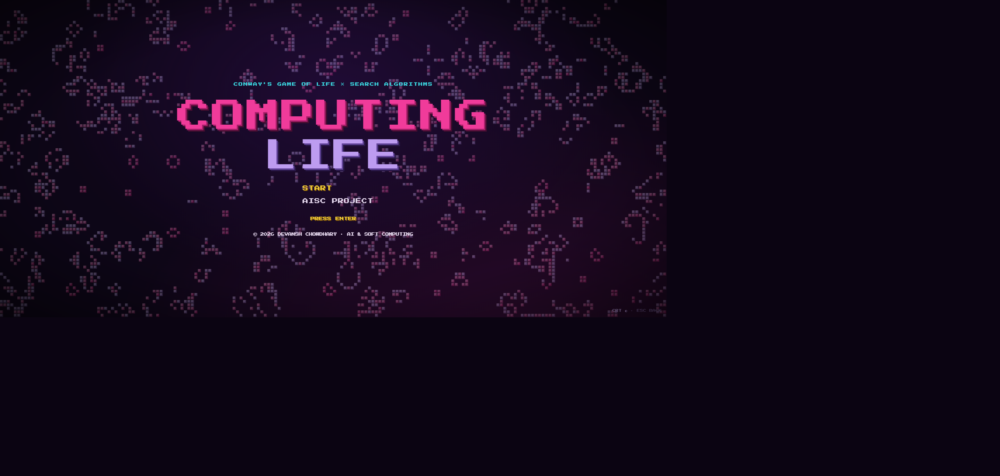
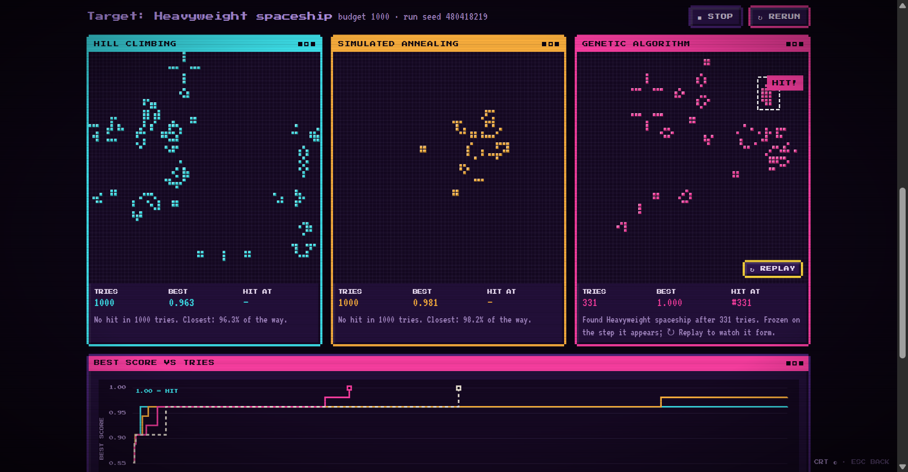

# Computing Life

**Can a search algorithm build a spaceship out of noise?**

A genetic algorithm, a hill climber, simulated annealing and plain random search race on an equal budget.
Each one tries to find a 16×16 starting pattern that grows, under Conway's Game of Life, into a chosen object:
a heavyweight spaceship, a pentadecathlon, or a shape you draw yourself.

Built as a course project for **AI & Soft Computing** (2026). The whole thing is plain JavaScript with no build
step and no dependencies. It runs in the browser for the live demo, and in Node for the benchmark.



---

## The story

### 1. A machine that builds itself (1940s)
John von Neumann wanted to know whether a machine could build a copy of itself, and what the simplest such
machine would be. Stanisław Ulam suggested he stop thinking about gears and wire and think about a grid of
cells instead, where each cell looks only at its neighbours. Von Neumann's answer was a cellular automaton with 29
states per cell, which contained a self-copying "universal constructor". It was published after his death, in
*Theory of Self-Reproducing Automata* (1966, edited by Arthur Burks).

### 2. Four rules (1970)
John Horton Conway tried to keep the idea and drop the complexity. He arrived at two states and four rules:

| A live cell with… | A dead cell with… |
|---|---|
| fewer than 2 live neighbours dies (loneliness) | exactly 3 live neighbours comes alive (birth) |
| 2 or 3 live neighbours survives | anything else stays dead |
| more than 3 live neighbours dies (crowding) | |

Martin Gardner published it in *Scientific American* in October 1970, and the **Game of Life** spread from there.
The patterns it produces have names: gliders and spaceships that travel, oscillators that pulse, and guns that
fire gliders forever.

### 3. Simple rules, unanswerable questions
Life turned out to be **Turing complete**. Its patterns can be wired into logic gates, memory and, eventually, a
whole computer (Paul Rendell built a Turing machine in it). That has an uncomfortable consequence. A question like
*"will this pattern ever produce a spaceship?"* can encode the halting problem. On an unbounded grid, no
algorithm can answer it for every pattern.

Going backwards is hard too. Some states have no predecessor at all ("Garden of Eden" patterns). For
two-dimensional cellular automata, deciding whether a given state has *any* predecessor is NP-complete for
some rules (Sutner).

### 4. Bound it, and it becomes search
Shrink the question and it becomes answerable in principle:

- a **16×16 seed** (256 cells, alive or dead), placed in a 64×64 wrapping world,
- run for at most **1000 steps**,
- and the question *does the target object appear, on its own, at any step?*

The question is now finite, but there are 2²⁵⁶ ≈ 10⁷⁷ possible seeds, more than there are atoms in a galaxy.
Checking every seed is out. What remains is **search**: generate candidates, score them, and use the score to
decide where to look next.

### 5. Where AI & Soft Computing comes in
This is the territory the course covers: a huge space, no gradient, and a score that comes from running a
simulation. The project races four ways of searching it:

| Searcher | Idea | Colour |
|---|---|---|
| **Random search** | A fresh random seed every try. The baseline: if nothing beats it, the "intelligence" is not helping. | bone |
| **Hill climbing (RMHC)** | Flip one cell. Keep the change if the score did not drop. Restart when stuck. | cyan |
| **Simulated annealing** | The same move, but sometimes accept a worse seed: often early ("hot"), rarely late ("cold"). | amber |
| **Genetic algorithm** | 20 seeds. Keep the best 2, and breed the rest by tournament selection, **block crossover** and mutation. | magenta |
| GA, uniform crossover | Each cell from either parent at random. It tests whether keeping 2D blocks together matters. | lilac |

**Fitness.** A seed scores 1 if the target appears isolated, in any orientation or phase. Otherwise it gets
partial credit: how close the world ever came to the target shape, as a share of the target's window.

**Fairness.** Every searcher gets the same budget of evaluations, counted by the evaluator rather than by the
searcher, and the same random-number seed. All randomness goes through one seeded generator, so every run can be
replayed exactly.

---

## Results

20 runs per searcher per target, 2,000 evaluations each. Run *i* of every searcher uses the same random seed.
(`npm run bench`, about 29 minutes on 16 cores. Raw data in `web/data/benchmark.json`.)

| Searcher | HWSS hits | median first hit | Pentadecathlon hits | median first hit |
|---|---|---|---|---|
| Random search | **12/20** | 818 | **3/20** | 1183 |
| Hill climbing | **13/20** | 797 | 1/20 | 243 |
| Simulated annealing | 11/20 | **441** | 2/20 | 1618 |
| GA (block crossover) | 11/20 | 546 | 2/20 | 1319 |
| GA (uniform crossover) | 8/20 | 1290 | 1/20 | 739 |

**The honest headline: at this budget, nothing beat random search.** Hill climbing's 13/20 against random's 12/20
is noise, and so are the gaps on the pentadecathlon, where every searcher hit 1–3 times out of 20.

What the numbers do say:
- **Partial credit is a weak compass here.** Every searcher reached 95–99% of the target's shape in almost every
  run, but being nearly a spaceship at step 400 says little about whether a neighbouring seed becomes one. Life is
  chaotic: one flipped cell changes everything 500 steps later. The guided searchers spend their budget near a
  near-miss, while random search keeps sampling fresh seeds, and on a target that appears roughly once in 1,500
  random seeds, fresh samples are what count.
- **When guided search does hit, it tends to hit sooner.** On HWSS, annealing's median first hit came at 441 tries
  and the block GA's at 546, against 818 for random.
- **Block crossover beat uniform crossover** (11/20 vs 8/20 on HWSS, with a faster median), which is the direction
  the building-block argument predicts. With n=20 it is a hint, not proof.

This agrees with a known result: Mitchell, Holland & Forrest (NIPS 1993) showed simple hill climbing beating a GA
by roughly 10× on a problem designed to favour the GA. A search algorithm is only as good as the signal its fitness
function gives it. Better signals are the next step: novelty search, fitness measured on the object's stable
debris, or a bigger budget with more runs.

---

## The app

`npm start` serves it at **http://localhost:5280/**. It is a multi-page, 8-bit CRT-styled tour:



- **Learn**: the four rules as flip cards, plus the history.
- **Sandbox**: a big grid you can paint on, with stamps for every known object and a HighLife rule toggle.
- **Gallery**: spaceships, oscillators, the Gosper glider gun and a self-replicator, all running live.
- **AISC project**
  - **Race**: pick a target and 2–5 racers. Each pane replays the best seed its searcher has found so far.
    When a searcher hits, its pane freezes on the moment the target exists, framed, with a replay button.
    Random search always runs as a dashed baseline on the chart.
  - **Single run**: one searcher, one target, with the score climbing on a chart.
  - **Results**: the benchmark, set against the history of your own races.
  - **Custom target**: draw a shape. It is classified (still life, oscillator, spaceship or transient) and becomes
    a target every searcher can race for.

## Run it

Requires Node 20 or newer. There is nothing to install.

```bash
npm start            # the app, on http://localhost:5280/
npm test             # 22 tests: engine, detection (known answers), GA operator contracts
npm run bench        # 20 runs × 5 searchers × 2 targets → results/benchmark.json
cp results/benchmark.json web/data/   # ship it to the Results page
```

The benchmark uses every core but two and saturates the CPU, so don't run it during a demo.

## How it is built

```
engine/        pure simulation and detection, no DOM; the same files run in the browser and in Node
  life.js        Life step (toroidal, column sums), hashing, seed placement
  patterns.js    RLE parser, targets and gallery exhibits
  detect.js      templates (every phase × 8 symmetries), isolated-match test, partial credit
search/        random.js · hill.js · anneal.js · ga.js · ga-operators.js (selection, crossover, mutation)
experiment/    evaluator.js (owns the budget and fitness) · job.js (one searcher, one target, one seed)
cli/           serve.mjs (static server) · run-experiments.mjs (worker_threads benchmark)
web/           the app: ui/screens, a Web Worker per searcher, self-hosted pixel fonts
tests/         node:test known-answer and contract tests
docs/          design, research, glossary, decisions, viva script
prototypes/    throwaway spikes that answered one question each
```

A seed is evaluated by stepping the world until a target match, a repeated state (the world is looping, so
nothing new can appear) or the 1000-step cap. Exact matches are checked every 4 steps, using a cheap anchor-cell
prefilter. Partial credit is checked every 8 steps.

## Docs
- [`docs/design.md`](docs/design.md): encoding, fitness, searchers, experiment protocol
- [`docs/research.md`](docs/research.md): prior art, target rarity, measured census, viability
- [`docs/GLOSSARY.md`](docs/GLOSSARY.md): the vocabulary used in code and UI
- [`docs/decisions.md`](docs/decisions.md): design decisions and their reasons
- [`docs/VIVA.md`](docs/VIVA.md): a five-minute demo path and likely questions

## Prior art
No source found runs this exact comparison: four searchers, an equal budget, and a named target. The closest
work is Wolper & Abraham (2015), whose evolved seeds' objective fitness collapsed to trivial oscillators, and
Turney (2025, arXiv 2501.04761), which uses mutation-only evolution toward a target. The rarity figures come from
[Catagolue](https://catagolue.hatsya.com/), the community census of over 10¹⁴ random 16×16 soups. Full notes are
in [`docs/research/prior-art.md`](docs/research/prior-art.md).

## Licence
Code: MIT. Fonts: Press Start 2P and VT323, under the SIL Open Font License 1.1 (texts in `web/fonts/`).
